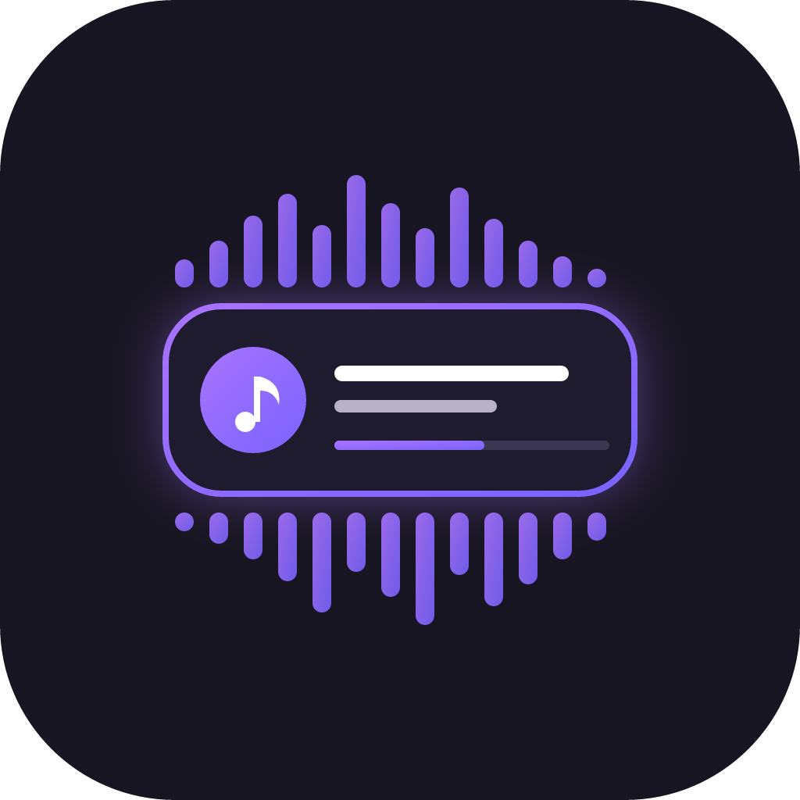
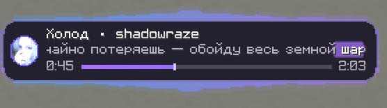

<table>
  <tr>
    <td align="center" valign="middle">
      
    </td>
    <td align="center" valign="middle">
      
    </td>
  </tr>
</table>
# Music Bar 

**Автор:** nikitamono AKA mtrsladkiy

**Загрузчик:** Fabric  
**Версия Minecraft:** 1.21.11  
**Зависимость:** Fabric API для Minecraft 1.21.11  
**Java:** 21 или новее  
**Сторона:** клиент

## Что это?

Music Bar переносит музыку, которая играет на твоём компьютере, прямо в Minecraft. На экране появляется компактный плеер с названием трека, исполнителем, текстом и визуализатором — удобно и для спокойного строительства, и для напряжённого PvP.

## Что внутри

- **Текущий трек всегда перед глазами.** Название, исполнитель, время и полоса прогресса показываются прямо во время игры.
- **Текст под музыку.** Мод может искать синхронизированные строки в LRCLIB или читать твой собственный LRC-файл. Строки сменяются плавно, а текущие слова подсвечиваются.
- **Обложка рядом с треком.** На Windows мод сначала пытается взять её из текущей медиасессии, в том числе от Spotify. Если обложка недоступна, он может поискать подходящую в iTunes; если поиск не удался, покажется значок ноты.
- **Визуализатор вокруг плеера.** На Windows мод пытается захватывать звук музыкального приложения отдельно от игры и строить волну по реальному звуку. Если захват не запустился, волны не появятся.
- **Сервер XudoBox под рукой.** При первом запуске мод добавляет в список серверов «Лучший BoxPvP» (`xudobox.online`), если его там ещё нет. Удалённый сервер повторно не добавляется.
- **Внешний вид под себя.** Меняй цвета, размер, положение, свечение и интенсивность пульсации в редакторе. Можно отключить отдельные элементы, например текст или визуализатор.

## Как начать

1. Установи **Fabric Loader 0.18.0 или новее** и **Fabric API** для Minecraft 1.21.11.
2. Помести JAR-файл Music Bar в папку `mods` своего экземпляра Minecraft. Если обновляешь мод, удали старую версию.
3. Запусти музыку и войди в игру. На Windows трек должен отображаться в системной медиапанели.
4. Нажми **J**, чтобы открыть настройки плеера. Если клавиша занята, переназначь её в управлении Minecraft.

### Хочешь видеть текст песни?

Онлайн-поиск текста по умолчанию выключен. Запусти игру один раз, закрой её и в файле `config/musicbar.json` установи:

```json
"lyricsOnline": true
```

При поиске название трека и исполнитель отправляются в LRCLIB. Обложки могут искаться через iTunes: для этого название и исполнитель отправляются Apple. Чтобы отключить поиск обложек, установи `"coverOnline": false`.

Можно использовать и свой текст: положи LRC-файл в папку `config/musicbar-lyrics` с именем `Исполнитель - Название.lrc`. Данные в имени должны совпадать с тем, что передаёт плеер; символы `\ / : * ? " < > |` замени на `_`. Локальный файл имеет приоритет перед интернет-поиском.

## Для создателей сборок

Music Bar работает на стороне клиента — ставить его на сервер не нужно. Внешний вид настраивается в игре, а дополнительные параметры хранятся в `config/musicbar.json`.

Мод распространяется по лицензии MIT. Можно добавлять его в сборки с соблюдением её условий — сохрани уведомление об авторских правах и текст лицензии из файла `LICENSE`.

## Совместимость и известные ограничения

- Конкретные конфликты с популярными модами пока не подтверждены; полноценного тестирования со всеми сборками не проводилось.
- Источник трека должен передавать название и исполнителя. Не все приложения передают обложку, позицию и длительность корректно.
- Тексты и обложки доступны не для каждого трека. Онлайн-поиск также зависит от доступности LRCLIB и iTunes в твоей сети. Если соединение сбрасывается, текст может не загрузиться.
- Обычные LRC-файлы часто содержат только метки строк, поэтому подсветка слов приблизительная. Для точных меток нужен LRC с временем отдельных слов.
- Захват звука отдельного приложения на Windows зависит от системы и плеера и может не запуститься. Если музыка играет в браузере, вместе с ней может захватываться звук других вкладок того же процесса.
- На Linux для получения трека и звука используются `playerctl` и `parec`; визуализатор там анализирует общий звук устройства. На macOS захват звука для визуализатора в этой версии не реализован.
- Экспериментальный сетевой патч использует PowerShell как запасной способ загрузки на Windows. Он не был проверен в игре на Windows и может не устранить ошибки соединения.

## Сборка из исходников

Понадобятся JDK 21+ и Gradle 9.8.2. В папке проекта выполни:

```bash
gradle build
```

Готовый JAR появится в `build/libs`. Файл с `-sources` в названии — архив исходников, не мод для установки. Для сборки нужны зависимости из репозиториев Gradle и Fabric.

## Автор и лицензия

Автор: **nikitamono AKA mtrsladkiy**. Код распространяется по лицензии MIT — см. `LICENSE`.
